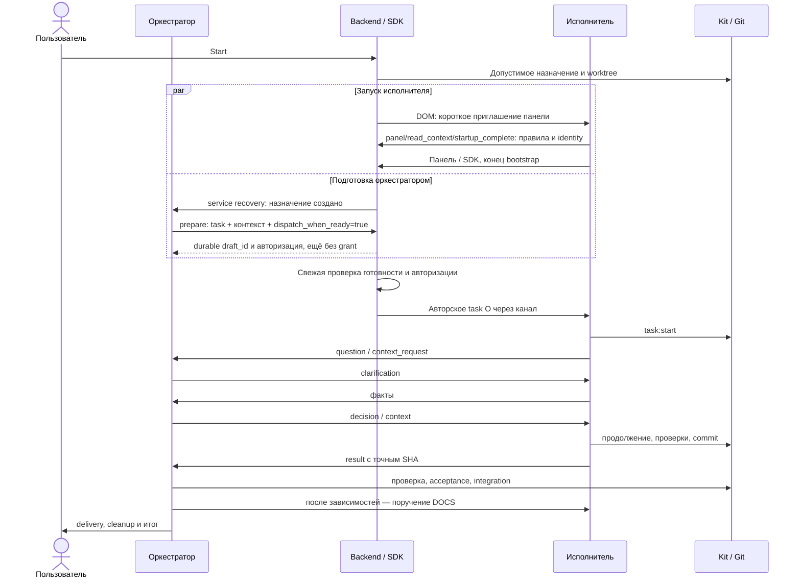

# Диалог под управлением оркестратора

Контракт Workflow Pilot 0.5.29 / Kit 1.9.7: `dialogue_version: 1`, ролевой протокол 7, панель `0.5.29-communication-4`, протокол панели 4. Новый orchestrated-план получает версию диалога автоматически при создании. Уже существующий план не переключается при чтении, расширении или обновлении Settings. [Надёжность и переход](assignment-dialogue-reliability.md), [живые опыты A–D](automatic-agent-dialogue-acceptance.md), [Kit](../../packages/workflow-kit/docs/modules/orchestrated-plans.md).

## Роли и пользовательский процесс

| Участник | Обязанности |
| --- | --- |
| Пользователь | Обсуждает цель и ограничения, согласует план, нажимает Start; решает вопросы вне разрешённого scope и принимает итог |
| Оркестратор O | Готовит spec/to-do и Review; выбирает задание и контекст каждого E; отвечает и уточняет; проверяет результаты; принимает конкретный SHA либо возвращает на доработку; выполняет интеграции, поручает DOCS, завершает delivery/cleanup и итог |
| Исполнитель E | Работает только в своём назначении/worktree; читает задание O; запрашивает недостающее; сообщает проблемы, выполняет решение, проверки и commit; обязательно отправляет result O |
| Workflow Kit | Хранит план, зависимости, разрешённые пути, назначения, блокировки, попытки, proof/acceptance; проверяет команды, коммиты и Git-интеграции |
| Backend / Control | Существующим scheduler создаёт допустимые назначения, запускает страницы и bootstrap; проверяет identity/допуск, сохраняет и доставляет сообщения, наблюдает завершение хода |
| Панель / SDK | Подключает адресный канал, пробуждает получателя и показывает факты; не владеет жизнью backend |

Kit и backend не выбирают содержательное поручение/контекст и не принимают результат вместо O. Backend-событие ready не является сообщением O. Локальный итог E не заменяет отчёт через канал. Пользователь не переносит идентификаторы и не пишет «Продолжай» между обычными ходами.

Новый O получает через DOM только приглашение панели, затем полный recovery и правила через [стартовый канал](orchestrator-startup.md). Он обсуждает scope, при включённом Review согласует spec/plan через Kit и публикует план. Публикация и открытая панель не разрешают реализацию. Единственная кнопка «Начать выполнение плана» разрешает scope; последующие «Пауза»/«Продолжить» управляют всем планом. Отдельных Enable и таймера 10/30 минут рабочего плана нет. Существующая сессия не получает полный bootstrap повторно при каждом следующем scope.

DOM остаётся для первоначальной загрузки и прежнего Review/legacy. Рабочие task/context/question/result идут через SDK и очередь. Представление уведомления хостом от имени user само по себе не доказывает DOM Send; диагностика различает SDK invocation и механический ввод в composer. Рабочего DOM fallback нет.

## Bootstrap и выбор контекста

Единственный bootstrap E содержит точный worktree/назначение, общие правила и запреты main/чужих задач, полные применимые обязательные AGENTS/Workflow Core/PROTOTYPE, каноническую роль и приглашение `workflow_pilot_panel`. Он требует закончить загрузочный ход и ждать task от O без `task:start` и модельного опроса очереди. Служебное название задачи — метаданные, не рабочее поручение.

Полный проектный recovery, история, все спецификации и task.context_pack автоматически E не прикладываются, в том числе при последующих recover/task:start/commit/compact. Ограниченный recovery содержит собственное состояние, правила, proof и точку продолжения. Обязательные ограничения передаются полностью и при необходимости частями; это не предлог вложить весь проект.

В версии 1 `task.context_pack` — рекомендованный список для O. O сам читает и выбирает достаточные материалы: цель, ожидаемый результат, границы, интерфейсы, критерии, проверки и данные задачи. Отобранный текст передаёт через `contexts: [{source, text, commit?}]`; backend сохраняет неизменяемые части, размер и SHA-256. `source`/`commit` — указанные агентом сведения о происхождении, digest удостоверяет сохранённые байты, а не самостоятельную проверку истинности текста. Локальные чтения E внутри разрешённой задачи допустимы.

До 16 источников, суммарно body и texts до 1 MiB; превышение отклоняется без обрезки. Чтение частей `0…total−1` обязательно до использования; доступ и digest проверяются для адресата. Недостаток до task:start позволяет `context_request` без фиктивного начала работы. Старые планы сохраняют прежнюю семантику context_pack.

## Подготовка одновременно с bootstrap

До публикации O сохраняет необязательный task_brief каждой обычной задачи и DOCS: цель, границы, проверки и выбранный контекст, непустой текст до 12000 байт UTF-8 без секретов. Simple plan:create сохраняет поле явно указанной DOCS при нормализации. Заготовка входит в Review и contract digest, но не даёт разрешения и не отправляется E. Старые планы без поля сохраняют прежний путь. В child plan поле остаётся частью неизменяемого контракта; recovery/bootstrap/status E его не выводят. Backend получает brief из родительского Kit с полномочием O.

Служебный read_message подготовки возвращает O актуальные task_brief, contract_digest и preparation_queue: до восьми ещё не прочитанных подготовок того же scope/получателя без SDK intent. O явно читает перечисленные message_id, сверяет назначения и готовит все доступные независимые поручения в текущем ходе; затем делает один yield обработанных входящих. Очередь сама не ставит read и не отменяет UNKNOWN. Ожидания накопления волны нет: поздние назначения получают обычное уведомление.

DOCS заранее содержит стабильные требования и перечень документов. Фактические SHA, результаты и актуальную базу O добавляет после проверенных интеграций. Backend не сочиняет поручение и не отправляет task_brief автоматически.

После создания допустимого назначения backend отправляет O служебное уведомление о подготовке, не дожидаясь панели E. O выбирает содержание и вызывает `workflow_assignment_prepare`: сохраняются текст, неизменяемые contexts и draft_id, привязанные к автору, project/scope/assignment/task/attempt и digest требований Kit. Черновик не является сообщением E, task grant или SDK-вызовом. Старый Kit без contract_digest получает предметный отказ capability; backend не выдумывает digest.

Основной путь: O указывает `dispatch_when_ready:true` в prepare. Одним вызовом сохраняются авторский текст и явное разрешение его отправки при готовности. Backend механически публикует тот же пакет после свежей проверки назначения, attempt/digest, binding/SDK, физического конца bootstrap и отсутствия команд E. Если канал уже готов, публикация возможна сразу. Отдельный ready-ход O не нужен. Без флага сохраняется только черновик; `workflow_assignment_dispatch` с `when_ready:true` разрешает его отложенную отправку отдельным действием O. Legacy dispatch без флага до готовности отклоняется. Медленный E не удерживает готового соседа; модельный polling не нужен.

Повтор с тем же ключом и содержимым идемпотентен в пределах автора и scope; другой scope не наследует черновик. Авторизация отдельно связана с generation/boot/recipient/assignment/attempt/digest. Смена поколения или restart требует новой авторизации O (`needs_confirmation`), а смена назначения/требований запрещает старую отправку. Посторонний коммит сам по себе не отменяет текст: O отвечает за актуальность источников. Pause допускает сохранение черновика активным O, но запрещает dispatch. Ненужные ещё не начатые ready/recovery того же назначения и попытки получают superseded; прочитанные требуют yield, SDK intent/UNKNOWN не получают выдуманного завершения. DOCS готовится со своим bootstrap только после проверенных интеграций.

Служебный read_message возвращает непрозрачный recipient_ref. Небольшой основной текст с `inline_context.complete:true` включён целиком с digest; повторный read_context не нужен. Большие части и дополнительные contexts читаются полностью. Полные обязательные ролевые инструкции сохраняются: прежнее чтение не доказывает сохранность контекста после compaction.

## Model API

| Инструмент | Контракт |
| --- | --- |
| `workflow_communication_participants` | Свой реестр назначений, task/title/attempt/состояние, opaque recipient_ref; O видит своих E, E — своё назначение |
| `workflow_assignment_prepare` | Только O: recipient, attempt, body, idempotency_key, contexts; dispatch_when_ready=true явно авторизует отправку при готовности, без флага только draft; ответ содержит `delivery_stage`/`delivered` |
| `workflow_assignment_dispatch` | Только O: свой draft_id; when_ready=true авторизует отложенную отправку; свежая проверка → intent → Kit → WAL |
| `workflow_assignment_send` | recipient, kind, attempt, body, idempotency_key; необязательные in_reply_to, contexts, block_id, problem_id, blocking, resume, source_commit, result_id |
| `workflow_communication_read_message` | Свой message_id; сохраняет read, возвращает полный текст/ссылки и актуальные инструкции |
| `workflow_communication_read_context` | message_id, context_ref, part; проверенные полные части |
| `workflow_assignment_yield` | message_ids прочитанных собственных сообщений, reason; подтверждает обработку, затем агент заканчивает ход |
| `workflow_assignment_status` | Факты очереди, receipt, назначения и ожидающие операции; не отправляет уведомление и не объявляет сообщения прочитанными |
| `workflow_assignment_migrate` | Только O старого рабочего плана после общей безопасной паузы; [контракт перехода](assignment-dialogue-reliability.md#переход-старого-плана) |

Все assignment-инструменты model-only. E задаёт recipient=`orchestrator`; O использует адрес из реестра, а не придумывает ID или выбирает sidebar. Автор определяется свежей host identity/назначением, не полем роли в payload. Контекст, чужая попытка, устаревший адрес, изменённый scope и удалённый проект проверяются до эффекта.

`yield.reason` — enum фактической MCP-схемы: `awaiting_reply` — ожидание ответа/ready; `tasks_sent` — поручения отправлены; `result_sent` — результат отправлен; `handled` — прочая обработка. Это квитанция обработки входа, не DONE и не самостоятельное доказательство физического конца.

Типы O: task, context, question, clarification, decision, revision_request, acceptance. Типы E: context_request, context, question, clarification, result. Ready/recovery/finalization имеют автора backend. Один operation/idempotency key с тем же содержимым возвращает прежний receipt; изменённое содержимое с тем же ключом — конфликт. Повтор не означает новый ход или новую работу.

## Проблемы и многоходовый диалог

E сначала устраняет очевидное препятствие в пределах задания. Если нужен O, сохраняет файлы и безопасное состояние команд, отправляет фактическую ошибку, попытки/результаты, недостающие сведения и точку продолжения. Блокирующий `question` использует blocking=true. Уточнения и факты относятся к тому же block_id и attempt. Только O `decision` с resume=true для актуальной блокировки возобновляет работу; clarification не снимает её и не расходует попытки ремонта.

После отправки вопроса E делает yield обработанного task и завершает ход. O уточняет, E отвечает, O принимает решение; каждый вход получает собственные read/yield. Ожидание ответа отдельно от транспортного ожидания конца хода, поэтому task не удерживает вход до DONE.

Совместимые CLI `task:block` / `assignment:message` остаются в том же журнале и корреляции, без двойной отправки. Для рабочего MCP агент не дублирует вопрос/решение CLI-командой: backend применяет эффект Kit один раз. Повтор со старым block_id/attempt не возобновляет новую работу.

Общую среду исправляет один владелец после свежей проверки, что затронутые E припаркованы, команды завершены и новых отправок нет. Независимые E продолжают. Исходники проходят назначения. Недостаток полномочий/секретов, изменение scope, неразрешимая проблема или третья неудачная попытка той же проблемы требуют предметной эскалации пользователю; подтверждения хоста не обходятся.

## Результат, доработка и интеграция

После успешного `commit --task` E обязательно отправляет result: изменения, реальные проверки/ограничения, полный source_commit, proof Kit, excluded_changes и артефакты. Backend проверяет существующий commit/proof назначения. READY_FOR_INTEGRATION, текст E и receipt доставки сами по себе не разрешают merge.

O читает отчёт, проверяет diff и проверки, затем отправляет acceptance для result_id и точного source_commit либо revision_request. Kit хранит acceptance/attempt и повторно проверяет их перед `integration:start/continue`. Новая версия SHA, грязный worktree, активные команды и pending transaction запрещают прежнюю приёмку.

Revision до интеграции создаёт новую попытку той же задачи/worktree, сохраняет прошлые commit/result/checks, отзывает прежнюю acceptance, создаёт разрешение новой попытки. E выполняет новые проверки/commit/result; O заново принимает. После INTEGRATED коррекция требует отдельной задачи. Самоприёмка E и повторный task:start завершённой попытки запрещены.

O выполняет последовательные интеграции в main штатными командами Kit. Только проверенный Git merge подтверждает INTEGRATED/DONE. Конфликт/check failure сохраняет operation_id, MERGE_HEAD и доказательства; O исправляет и вызывает continue без принудительного ours/theirs или reset. Зависимые назначения требуют проверенных интеграций, чистого main, отсутствия команд и свободной операции Kit; текстовый ответ O сам по себе не задерживает bootstrap DOCS. Kit повторно проверяет scope/revision/base под блокировкой. WORKFLOW_LOCKED во время setup — ожидание без удаления lock и без эскалации; после сверки повторяется та же операция. Карточка O и строки плана используют одну проекцию своего scope. Автоматического merge по READY нет.

После обычных задач O поручает DOCS с итогами и выбранным контекстом, затем выполняет delivery, `assignment:cleanup`, проверку main и итог пользователю. Последняя acceptance E должна иметь read/yield и свежий физический конец. Backend связывает эту квитанцию с точными assignment/attempt/source_commit в Kit через внутреннюю `assignment:transport`; агент её не вызывает. Ранняя cleanup получает PENDING и автоматически продолжается после квитанции и окончания команд E. Удаление worktree не отнимает у O возможность видеть доказанные INTEGRATED/result/acceptance в реестре; это чтение родительской записи, не разрешение новой работы E.

Итоговое поручение может прийти после обязательных интеграций/delivery до последних acceptance E. O использует проверенные proof точных SHA; неизменившиеся успешные проверки не повторяет без причины. Оно не подтверждает cleanup: при любом null/PENDING нужно вызвать assignment:cleanup, при явном DONE всех назначений повтор не нужен. Backend продолжает раннюю очистку после квитанций. Новые исходники требуют проверки нового main; proof E не заменяет проверку интеграции.

Все DONE, обработанные сообщения, cleanup DONE, чистый main, отсутствие команд и физический конец итогового O предшествуют complete и отзыву связи. До этого UI отдельно показывает «Результаты исполнителей X/N» (checked source) и «Интегрировано Y/N» (Kit DONE); `pending` не считается доставкой. Все DONE при `READY_FOR_ACCEPTANCE` показываются как ожидание приёмки даже с ACTIVE scope, а не активная работа. `DOCS checks:[]` означает отсутствие запуска application tests этим коммитом; их результаты — в receipts прежних задач. После complete нет «Паузы». Пользователь сообщает O: «Принимаю результат, закрой план». Архив проекта не подменяет Kit archive scope. Restart сохраняет complete. [Тайминги и стадии](dialogue-timing.md), [живые испытания NOT_RUN](../acceptance/interruption-recovery.md), [архив](project-lifecycle.md).

Итог по умолчанию — несколько предложений: результат, проверки/ограничения, оставшийся этап либо приёмка. Повторный анализ WAL и таблицы времени не обязательны; явный запрос пользователя подробного отчёта имеет приоритет. После yield интерфейс показывает «Завершается итоговый ответ», пока не подтверждён физический конец. Другие барьеры завершения показываются по фактической причине.

Канонический текст ролей — `packages/workflow-kit/src/lib/role-protocol.mjs` (версия 7). Recovery, startup, шаблоны PLAN/PROTOTYPE/WORKFLOW, MCP instructions/descriptions и backend validation согласованы. Обновление правил открытого чата не повторяет уже сделанные действия.

Старт всех новых локальных сессий — [единый канал панели](orchestrator-startup.md), независимо от стратегии и состояния плана. DOM содержит только приглашение; ролевые правила E тоже читаются через MCP. Старый генератор вложений отключён. Получение пакета не назначает O и не разрешает выполнение задач.
