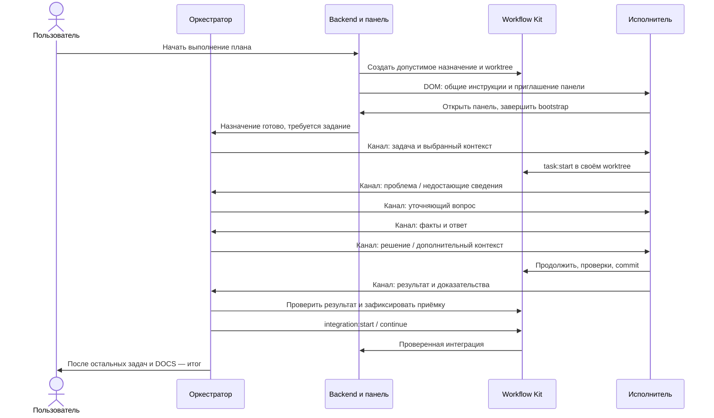

# Диалог под управлением оркестратора

## Поручение и результат

Scope `orchestrator-owned-dialogue-refactor` согласован с Claude Review. Пользователь разрешил реализацию и выпуск одним агентом. Прежний scope закрыт коммитом `99e36fd1df663fb269ddf6f695423f5bd5a44fe9` организационно, без PASS живой приёмки. Несколько E ниже — участники продукта и его проверок.

Цель: после одного Start оркестратор самостоятельно поручает работу двум и более исполнителям, выбирает необходимый контекст, ведёт диалог об ошибках и недостающих данных, принимает результаты и выполняет проверенные интеграции. Пользователь обсуждает план, запускает его и получает итог. Ручные открытия чатов/панелей, копирование идентификаторов, Enable и «Продолжай» между обычными рабочими ходами не нужны.

Контракт включает этот документ, [результаты](orchestrator-owned-dialogue-results.md) и [надёжность/приёмку](orchestrator-owned-dialogue-reliability.md). Все три части обязательны.

## Установленная проблема

Тест `Workflow_Pilot_Plugin_Test_02`, 0.5.7: E активировались после посещения карточек; T002 начал подготовку до собственного выбора, точная причина задержки ещё не установлена. Оба сделали проверенные коммиты, но O не получил отчёты и план не завершился.

Код: startupMessage передаёт E полный recovery, DialogueDelivery.start сочиняет рабочую команду backend. Отдельное SDK-уведомление действительно accepted/read, что не доказывает авторство O. Legacy send отвергает рабочие назначения; обязательного E → O result и соответствующей инструкции нет.

WorkflowChannel.observed требует новой user revision вместе с ответом ассистента. Изолированно воспроизведён удержанный gate при SDK accepted/read и новом ответе без пользовательской реплики. Это транспортный сбой, не отсутствие результата Kit.

## Неизменное начало пользовательского процесса

1. Пользователь открывает локальный репозиторий в workspace и новый разговор будущего O. Существующий DOM-bootstrap передаёт O полный актуальный recovery, проектный контекст, инструкции и приглашение открыть панель. Ограничение DOM относится к нашей текущей интеграции; утверждений об отсутствии любых альтернатив у OpenAI нет.
2. Пользователь и O обсуждают scope. O готовит спецификацию и план, при Review ON обсуждает их с рецензентом через Kit. План виден пользователю. Публикация и открытие панели не запускают реализацию.
3. Пользователь нажимает единственную кнопку «Начать выполнение плана». Start разрешает этот scope, его назначения и диалог до завершения, паузы или отмены. Нет отдельного запуска связи или таймера на 10/30 минут во время активного выполнения.
4. При продолжении существующей сессии новый план не требует повторной передачи полного recovery через DOM. Используются актуальные состояние и инструкции без повторения уже выполненных действий.

Review планирования, DOM-bootstrap O, одна кнопка Start/Пауза/Продолжить и существующие ограничения выполнения сохраняются.

## Обязанности участников

| Участник | Обязательная работа | Граница ответственности |
| --- | --- | --- |
| Пользователь | Цель и ограничения, обсуждение/согласование плана, Start, добровольная пауза/удаление, решения вне полномочий агентов | Не служит курьером сообщений и не восстанавливает обычные технические блокировки |
| Оркестратор O | Спецификация/to-do; содержательное задание каждому E; отбор контекста; ответы и уточняющие вопросы; решение технических препятствий; проверка результата; решение о доработке/приёмке; интеграция, DOCS-поручение, delivery и итог | Не делегирует ответственность за решение backend; обычные изменения исходников проходят назначения; общую среду меняет только при исключительном владении |
| Исполнитель E | Подключение панели; чтение адресного задания; работа в своём worktree; запрос конкретно недостающего; сообщение о блокировке; выполнение решения; проверки и commit; обязательный адресный результат O | Не меняет main/общий план/чужие worktree, не создаёт вложенных E, не начинает следующую задачу; локальный финальный ответ не заменяет отправку результата |
| Workflow Kit | План и зависимости, области изменений, worktree/назначения, task:start/commit/checks, доказательства результата и интеграции, состояние блокировки/исправления/приёмки и cleanup | Не сочиняет рабочее задание, не выбирает содержательный контекст и не принимает результат вместо O |
| Backend / Control | Действующий scheduler; механическое создание разрешённых назначений; автоматический bootstrap; проверка identity/разрешения; адресация, долговечная доставка и пробуждение; согласование состояния с Kit | Не имитирует авторство O/E; не дописывает за агента результат; не включает второй scheduler или отдельный план диалога |
| Панель / SDK | Подключение и отображение адресного канала, SDK-уведомления, участники и фактические состояния доставки | Панель не владеет жизненным циклом backend; её открытый вид не доказывает доставку или выполненную задачу |

## Последовательность после Start

Очередь backend/SDK сохраняет task до готовности E и ready при занятом O. Ready содержит проверенные метаданные; страница не доказывает получение. Scheduler соблюдает зависимости/лимит, O поручает DOCS и выполняет delivery в main.

## Минимальный bootstrap исполнителя

Единственная начальная DOM-отправка E содержит:

- роль, точный собственный worktree, привязку к назначению и запреты изменения main/чужого задания;
- обязательные применимые правила проекта и выполнения инструментов, общий канонический протокол поведения E и его версию;
- одноразовое приглашение автоматической регистрации через workflow_pilot_panel, без вывода пользователю секретов и transport ID;
- правило закончить bootstrap и ожидать адресное задание O, не вызывая task:start и не опрашивая очередь модельными ходами;
- порядок обработки задач, вопросов, блокировок, результатов, повторов и ожидания.

Backend не включает проектный recovery/историю/спецификации/context_pack/рабочее поручение в bootstrap E. Название/ID — только привязка. Полные обязательные ограничения передаются отдельно, при превышении бюджета — проверяемыми частями, без скрытого вложения проекта.

Recovery E содержит собственные состояние, правила, proof и точку продолжения. Это сохраняется при task:start/commit/recover/compact; повторное подключение не повторяет bootstrap/задание.

## Задание и контекст от O

O формирует поручение: цель и ожидаемый результат, границы изменения, релевантные интерфейсы/ограничения, критерии приёмки, необходимые проверки, выбранные сведения и точку возврата результата. Оно связано с существующей задачей плана и не расширяет её полномочия.

O выбирает текст, фрагменты или конкретные документы, достаточные этой задаче. Backend может механически прочитать выбранные O ресурсы через Execution и сохранить неизменяемый снимок; список выбирает O. Снимок содержит источник/commit при наличии, размер и digest. Большой контекст передаётся целыми нумерованными частями без обрезки. Проектные ограничения и утверждённые критерии остаются обязательными, даже если O их случайно не пересказал.

В новом режиме task.context_pack является рекомендованным стартовым списком материалов для O, а не автоматическим вложением исполнителю. O при выдаче задачи выбирает фактически нужное и затем дополняет контекст по запросу. Обязательные проектные ограничения передаются отдельным полным слоем; эта смена смысла не разрешает их пропускать. Шаблон PLAN.md должен описывать такой отбор и приёмку каждого результата O до интеграции, без ожидания общего финального поручения backend. Для legacy-планов прежняя семантика context_pack сохраняется.

Локальные чтения E внутри разрешённой задачи допустимы: минимальный передаваемый контекст не является файловой изоляцией.

## Рабочие инструменты и адресация

Добавить отдельный model-инструмент `workflow_assignment_send` для рабочих назначений. Legacy `workflow_communication_send_message` сохраняет прежний экспериментальный контракт. Использовать существующие чтение сообщений/частей контекста и реестр, расширив их для рабочего диалога. Не заставлять агента вручную конструировать run_id, participant_id, URL или токены.

- E использует адресат `orchestrator`; backend выводит O из проверенного проекта/scope/назначения. E не может обращаться к чужому E/проекту.
- O выбирает opaque адресат из реестра активных назначений с task_id, названием, статусом и именем E. Реестр не зависит от выбранного чата sidebar; четыре-пять E различимы. Повторное назначение той же task_id имеет другую identity/attempt.
- Автор выводится из проверенной host identity. Авторство модели отделено от service-событий backend. Если identity не подтверждена, запрос отклоняется; роль из тела сообщения не является доказательством.
- Конверт включает message_id, проект/scope/назначение/попытку, тип, автора/адресата, in_reply_to, conversation/question/block correlation, idempotency key, версию протокола и ссылки на контекст. Агент получает необходимые ссылки от инструментов; пользователь их не переносит.
- Типы: task, context_request, context, question, clarification, decision, result, revision_request, acceptance. Сервисные ready/recovery/finalization имеют отдельного автора backend и не разрешают самостоятельную выдачу рабочего задания.
- Повтор того же ключа и содержимого возвращает прежний результат; тот же ключ с другим содержимым — конфликт. Проверять адресата, scope и актуальность перед эффектом. Один отчёт относится к одному результату/попытке; дубликат не создаёт новый ход, исправление или интеграцию.

`workflow_assignment_yield` подтверждает обработку собственных прочитанных актуальных сообщений с причиной завершения хода; затем агент заканчивает ответ. Это не DONE и не физический idle: полный gate-контракт — в обязательной части «Надёжность», разделе «Ходы и доставка». `workflow_assignment_status` читает очередь/receipt без уведомления. Наружный контракт и ошибки закрепляют T001/T002.

## Блокировки и многократный диалог

E самостоятельно решает очевидное препятствие внутри назначения. Если данных или разрешённого способа исправления не хватает, он сохраняет состояние, доводит команды до безопасной точки и отправляет O факты: ошибку, попытки и результаты, состояние файлов/процессов, недостающие данные, точку продолжения. До task:start разрешён context_request; для него не требуется фиктивно начинать задачу.

Вопрос допускает безопасную независимую работу либо блокирует назначение до решения. Конец хода не завершает назначение. Многоходовые уточнения сохраняют block_id и счётчик попыток ремонта; только актуальное решение O resume=true снимает блокировку. Ответ старой попытке новую не возобновляет.

`task:block` и `assignment:message` сохраняются как совместимые пути в тот же протокол. Для нового MCP-вызова backend один раз применяет соответствующее изменение Kit; агент не обязан дополнительно дублировать его CLI-командой. Старый сигнал и новое сообщение имеют общую корреляцию/idempotency и не создают две доставки. Общая canonical role-protocol описывает один рекомендуемый путь нового режима.

O выбирает решение: дать сведения, поручить ремонт этому E, создать корректирующее назначение в разрешённом scope или исправить общую среду при исключительном владении. При работе O с общей средой затронутые E припаркованы, их команды завершены/остановлены безопасно; после проверки следует адресное возобновление. Отсутствие полномочий/секрета, изменение scope, неразрешимая ситуация или три безуспешные попытки той же проблемы требуют предметной эскалации пользователю. Скрытого обхода подтверждений хоста нет.
